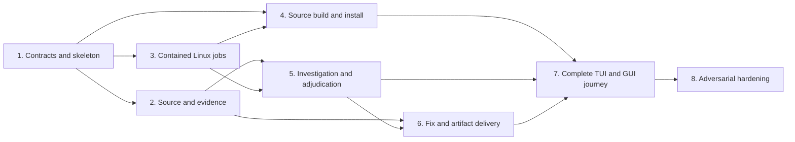

# Peritus Red Team — phased implementation plan

Status: Phases 1–3 implemented and real-interface verified in local working trees; Phases 4–8
have not begun.

Date: 2026-10-23.

Canonical product design: [red-team.md](red-team.md).

## How to use this plan

This plan turns the agreed Red Team design into dependency-ordered implementation phases. A phase
is a maturity boundary, not a provider turn, a runtime campaign stage, or a single issue. When
implementation is authorized, split each phase into small issues that make one concrete observable
change and can ordinarily be completed in a few minutes. Close an issue only after its stated
observable result exists and its handoff record is durable.

Each phase receives a focused context containing the accepted design, relevant interfaces, retained
evidence from prior phases, and its explicit permitted work. It does not rediscover the repository
or reconsider settled product decisions. The handoff names exact source and schema revisions,
artifacts, real-interface observations, unfinished work, and known limitations. Later phases consume
those identities rather than summaries that cannot be checked.

The maturity sequence is deliberate:

| Maturity | Objective | Phases |
| --- | --- | --- |
| 1. Skeleton | Establish complete architecture and honest unsupported paths. | 1 |
| 2. Coverage | Implement every required subsystem with minimum real functionality. | 2–6 |
| 3. Integration | Make the whole user journey operate end to end. | 7 |
| 4. Hardening | Challenge recovery, containment, evidence integrity and hostile inputs. | 8 |
| 5. Optimization | Improve a measured bottleneck after the complete workflow exists. | Future work only |

Necessary efficiency work that makes a current phase usable is allowed. Speculative optimization,
polish, or generalized rewriting is not allowed while an earlier required subsystem remains absent.
There is no cumulative token, iteration, or campaign-duration budget. Individual jobs still need
resource admission, cancellation and bounded effects so the application keeps working.

## Dependency and handoff flow

Phases 2 and 3 may proceed independently after Phase 1 if they retain the same contract revision.
Phase 4 depends on the contract and contained-job foundations, not on security discovery. Phase 6
depends on evidence and investigation semantics. Phase 7 is the first complete product journey;
earlier phases must still expose enough real controls to inspect, pause and cancel their work.

## Phase 1 — contracts and end-to-end skeleton

**Maturity:** Skeleton.

**Objective:** Establish the complete ownership and compatibility shape before implementing the
security engine. An unsupported operation must fail explicitly rather than appearing to work.

**Permitted work**

- Define versioned SDK and host capability contracts for explicit source selection, scoped source
  handles, owned background jobs, source packages, local build identities and native module actions.
- Define stable record identities and schemas for scope revisions, source snapshots, jobs, evidence,
  findings, patches, reviews and reports.
- Create the Rust module boundaries, framed native entry point and canonical Red Team skill resources.
- Add capability negotiation and actionable compatibility results while preserving ABI-one native
  modules and the existing Deep Research package path.
- Provide a thin vertical path that can open the module, show its status, save a checkpoint and say
  exactly which unimplemented capability prevents further work.

**Not permitted yet**

- No ambient filesystem discovery, direct process spawning, pretend source catalog entry, fake
  executable digest, security finding, or successful campaign claim.
- No generated module binary, package, cache, transcript or campaign data committed to Git.

**Deliverables**

- Versioned contract definitions and compatibility matrix.
- Rust source layout and canonical `SKILL.md`, with every unsupported path explicit.
- Minimal module menu/status/checkpoint journey using the real native protocol.
- Schema fixtures sufficient to reopen and reject incompatible skeleton records honestly.

**Real-interface exit evidence**

- Launch the source-built development module through Peritus and observe menu, status and checkpoint
  behavior through the native protocol rather than calling internal functions directly.
- Run it against a host that advertises the new contract and one that does not. The latter reports
  the missing capability before attempting an effect; an existing native module still operates.
- Inspect the tracked repository and confirm the new Red Team area contains source and resources,
  not compiled module artifacts or campaign output.

**Handoff:** exact contract/schema revisions, compatibility observations, module/skill identities,
unsupported capability list and the next owners. Covers R1, R12–R15 and the compatibility portion
of A11; it does not satisfy the complete campaign acceptance criteria.

### Phase 1 implementation record — 2026-10-23

Phase 1 is complete in uncommitted working trees based on Module Market `main`
`6b2cca73161b3f0e4ab004f9a124e4e01e84ca89` and Project Peritus `develop`
`8933e81370a86b02009471eb517c1bc30bdd815f`. The shared module-host contract is version 1; its two
source copies are byte-identical with SHA-256
`89a5b94b9f29c51fad8ca4995124c56ac95792720e42c2332d371408942afb52`. The Red Team module is
`peritus.red-team` version `0.1.0`, its durable skeleton schema is version 1 with fixture SHA-256
`060b2710b19fcfd19a467ab0038cad0b38db9426d678bbe6de9440e039b4b602`, and its canonical skill has
SHA-256 `b5fb445df881db4790d175b79c9b7e0eebaa6e5d84ebb196939bda1458604c09`. Inert version-one record
contracts for campaigns, scope revisions, source snapshots, jobs, evidence, findings, patches,
reviews, and reports have source SHA-256
`5d1a59f578cfb9e680ffa60094003414ab03f3c5b8cfecab50b5c4ee0362480a`; serializing them grants no
authority and establishes no evidence or finding.

The source-built development executable had SHA-256
`d67c1c4939b5b130dc659c76df07ab4d48ac5970811a4edfd0a25c9ce0232ccb`. It was copied into a
disposable package outside Git, installed under isolated Peritus state as package digest
`89faae3fdfd419c5ac4d05204ee4bb59ae6f50b3c8f14513163523d6ac139181`, explicitly enabled, and
opened in a fresh conversation. This is test evidence, not a market package identity; the source
template remains deliberately non-runnable and `market.toml` is unchanged.

Observed real-interface results:

- WebUI run `177f75b39f2252b40f2a8df6f3c16ff8` crossed the actual browser client, daemon, product runner,
  plugin host, and native process before the inert record-contract-only addition. It advertised only
  the five implemented version-one capabilities and named `module.scoped-source`,
  `module.owned-jobs`, and `module.source-build` as unavailable before any effect.
- The final package and rebuilt Peritus binaries ran through the actual TUI as run
  `0b746cef9a7fef10596165cc0bca543a`. A fresh conversation negotiated the same honest capability
  result, submitted `checkpoint`, displayed the module checkpoint, and then displayed its durable
  acknowledgement. It also stated that no source was selected and no target code executed.
- A framed executable replay passed six scenarios: missing host profile, updated-host capability
  negotiation, checkpoint write/ack, fresh-process state reopen, premature `start` refusal, and
  existing Deep Research handling of the additive host profile. The final disposable JSON evidence
  is `/tmp/peritus-red-team-phase1-native-evidence-final-records.json`.
- Existing Deep Research package `1.4.0` was also installed and enabled in the isolated registry.
  Actual TUI run `438e772d45085615db8b5f1e793d241a` returned its ordinary no-saved-job `status` reply through
  the updated host, rather than rejecting the additive host profile or entering the Red Team path.
- The Red Team and market SDK crates built and passed strict Clippy; the canonical skill validator
  passed. The final Peritus daemon, CLI, TUI, and WebUI binaries built successfully. Project
  Peritus's package-wide strict Clippy command still reports its pre-existing broad lint backlog;
  the Phase 1-specific new receiver warning was corrected rather than suppressed. No unit tests or
  formal verification were run.
- Repository inspection found only Rust/text/JSON resources in `modules/red-team`, no market entry,
  and no compiled binary, package, cache, transcript, or campaign output under the new source area.

Architect verdict: **ready for Phase 2** at the Phase 1 contract boundary. This verdict covers the
skeleton and compatibility slice only; it is not a claim that a Red Team campaign can yet select,
execute, investigate, fix, or export an application.

## Phase 2 — scoped source and durable evidence foundation

**Maturity:** Coverage.

**Objective:** Give campaigns an explicit, revocable source boundary and durable evidence whose
identity can be checked across restarts without repeatedly reading unchanged source.

**Permitted work**

- Implement host-approved source selection, exclusions, immutable snapshots or scoped handles,
  scope revisions and original-project preservation receipts.
- Reject traversal, unsafe links, special files, root overlap, mixed-revision capture and attempts to
  rehydrate revoked or excluded source through retained archives.
- Implement content-addressed artifacts, file-digest/range observations, dependency edges, atomic
  publication, recovery and selective invalidation.
- Implement campaign, hypothesis, coverage, evidence and report records with the classifications in
  the canonical design. Store large bytes separately from small checkpoints.
- Record source reuse, repeated-read reasons and coverage gaps without claiming that examined means
  secure.

**Not permitted yet**

- No target code, hooks, generators or configuration executes during inert source capture.
- No source outside the explicit application root becomes a target because it is referenced, linked,
  downloaded or discovered by an agent.

**Deliverables**

- Scoped source broker and snapshot/handle records.
- Durable artifact and dependency store with recovery and selective invalidation.
- Coverage and finding ledgers plus honest partial Markdown/JSON reporting.
- Original-project byte manifest covering tracked and untracked input state.

**Real-interface exit evidence**

- Select a real disposable project through the product interface; capture it, reopen it in a fresh
  process and retrieve retained evidence by identity.
- Attempt excluded-path, traversal, symlink, special-file, root-overlap and scope-revocation cases;
  observe rejection without forbidden reads or writes.
- Change one source file and then an unrelated file. Only dependent observations invalidate, while
  byte-identical reads reuse retained evidence and report the reuse.
- Interrupt artifact publication and damage a copied artifact; neither may reopen as complete.

**Handoff:** scope revision, source snapshot, artifact/schema versions, coverage ledger, original-byte
manifest, reuse measurements and unresolved exclusions. Covers R2–R4, R6–R7, R10–R11, R16–R17 and
the source/evidence portions of A2, A3, A8 and A9.

### Phase 2 implementation record — 2026-10-23

Phase 2 is complete in uncommitted working trees based on Module Market `main`
`6b2cca73161b3f0e4ab004f9a124e4e01e84ca89` and Project Peritus `develop`
`8933e81370a86b02009471eb517c1bc30bdd815f`. The shared module-host contract remains version 1;
its two source copies are byte-identical with SHA-256
`799905d01c48760230ac45bc32cb5960c7d41b34c6bb660a593f95ae800ce891`. Red Team campaign state is
schema 2, its canonical empty fixture has SHA-256
`52787ad320cef6512a34ef946e7882d69d136e7d74ba9ea17c530670d54500ff`, and Phase 1 state migrates
forward rather than being reinterpreted in place.

The host now advertises and enforces `module.scoped-source` version 1. It binds capture to the
explicit original source associated with the opened workspace, rejects overlap with module-private
state, applies mandatory and user exclusions, reads only no-follow regular files, detects a source
revision changing during capture, publishes source and manifest bytes through the existing
content-addressed artifact store, and returns only an opaque revocable handle and metadata. Snapshot
indexes and the module checkpoint are small atomic JSON records; bulk bytes remain outside them.
Refresh verifies and reuses unchanged artifacts, reports changed and removed paths, and lets the
module invalidate only observations that depend on those paths.

The source-built release executable had SHA-256
`da47f9b02898e56a09635802e746d326e15f20ccb988f39553984a95e240b0a8`. A disposable package was
installed outside Git with digest
`23e1986b4b0c190c63e9656e136b729ff6ebbf4ef1dc14bee0b7c3d767014e0f`. Primary WebUI run
`53ef6fe64abec64b5c5aa8cbf31c3e1c` ended at scope `scope-6-aab3f1a62244e3cb` and snapshot
`aab3f1a62244e3cb2b315485d4dc17accb8189b2871c5ae63dbb753d29c40d39`: four files, 183 bytes,
all four files reused on the unchanged refresh, two current observations, two selectively invalidated
observations, 15 unexamined security families and no claimed finding.

Observed real-interface results included fresh-process reopen; exact range reuse; tracked and
untracked source; paged 109-file manifests; paths with spaces; empty files and EOF reads; independent
SHA-256 agreement; rejected traversal, excluded paths, unsafe exclusions, symlinks, FIFOs, private
state overlap and revoked handles; changed/removed-path invalidation; and unchanged-snapshot reuse.
Killing the daemon partway through a 1 GiB sparse-file capture admitted no scope, and retained
`resume` reissued the exact request after private staging recovery. Mutating a 512 MiB source during
capture produced `mixed_source_revision` and no published index. Deliberately corrupted copied
artifact state was quarantined and could not reopen as complete. Partial Markdown and JSON reports
kept every security family explicitly unexamined.

The campaign exposed and corrected five implementation faults: the managed-worktree path initially
lost the explicit original source root; interrupted source staging was not recovered; a pending host
request could not be reissued after restart; legal empty artifacts were rejected by a zero-byte
transport limit; and corrupt-store failures lacked an actionable fresh-campaign recovery instruction.

The Red Team crate passed offline `cargo check`, strict package Clippy and its release build. Project
Peritus's product runner and daemon passed `cargo check`, and its CLI, daemon, TUI and WebUI binaries
built. Unit tests and formal verification were not run. Workspace-wide formatting remains blocked by
pre-existing deleted shell-tool fixtures, and workspace-wide strict Clippy remains blocked by the
existing unrelated lint backlog. The retained Project Peritus record is
`docs/testing/red-team-phase2-real-2026-10-23.md` with a 24-scenario JSON companion.

Architect verdict: **ready for Phase 3** at the Phase 2 source-and-evidence boundary. This verdict
does not claim target execution, containment, investigation, patch validation, store installation or
a complete Red Team campaign.

## Phase 3 — contained Linux jobs and dependency preparation

**Maturity:** Coverage.

**Objective:** Execute untrusted target preparation and proof work as host-owned jobs inside enforced
Linux boundaries, with accurate lifecycle control and trusted observations.

**Permitted work**

- Implement the generic asynchronous job service: submit once, poll status and bounded logs, cancel,
  reconcile after disconnect and recover without relaunching the same side effect.
- Choose and implement the first Linux isolation backend with aggregate CPU, memory, process, storage,
  filesystem and network controls based on available resources.
- Separate dependency preparation from proof execution. Permit constrained declared dependency
  retrieval during preparation, record identities and redirects, then remove egress and credentials.
- Keep the target, attacker inputs, victim state, evaluator, hidden canaries and trusted controller in
  appropriately separate boundaries. Bind receipts to the actual launched target and oracle.
- Enforce live Process/Write authority, scope revision, module/version identity, cancellation ownership
  and cleanup of descendants.

**Not permitted yet**

- No unrestricted network, host service, provider credential, registry probing, upstream probing or
  ambient host process/filesystem access from proof jobs.
- No fallback to unrestricted execution when containment is unavailable.

**Deliverables**

- Generic host job broker and versioned job/capability contracts.
- Linux isolation and constrained preparation adapters.
- Trusted controller/evaluator receipt format and hostile-output discrimination.
- Lifecycle recovery, revocation and resource-failure reporting.

**Real-interface exit evidence**

- Build and operate an actual vulnerable and corresponding safe target inside containment. A trusted
  observation distinguishes them; printing a success marker or causing an unrelated crash does not.
- Let a job run beyond the native call deadline and observe polling rather than relaunch. Exercise
  Pause, Stop, host exit, cancellation, timeout, OOM/process pressure and restart; descendants stop and
  the retained result says what actually happened.
- Retrieve an allowed dependency during preparation, then demonstrate that the proof job cannot use
  that egress, reach host/private services, access a credential, or target the registry/upstream.
- Substitute a fake target/controller output and expose a canary to the attacker; forged evidence does
  not receive the authentic trusted status.

**Handoff:** job/backend versions, enforced resource policy, target/evaluator identities, lifecycle
receipts, preparation manifest, cleanup observations and unsupported-platform result. Covers R2, R5–R6,
R10, R12, R14, R16 and the execution portions of A2, A4, A5, A12 and A14.

### Phase 3 implementation record — 2026-10-23

The host now advertises `module.owned-jobs@1` only when the configured Linux runtime is available.
Its version-one service provides idempotent submit, long-poll status, bounded stdout/stderr reads,
exact cancellation and durable reconciliation. A nonterminal record without its original in-memory
owner becomes `Indeterminate`; recovery never relaunches the side effect. Receipts bind the module,
source handle and revision, target, execution plan, host-generated oracle, backend, resource policy,
terminal result, output artifacts and cleanup observation.

The first proof adapter is `linux.canary-disclosure.v1` over `peritus-linux@1`. It materializes only
the immutable selected target into a private scratch root, clears the environment, supplies no
secrets, denies network, uses PID/user/IPC/UTS/network namespaces plus Landlock, seccomp and a
delegated cgroup v2 leaf, and applies finite memory, storage, CPU, wall, output and process limits.
The host alone creates and evaluates the hidden canary. Dependency preparation is separately owned
by `https.dependency-fetch.v1` over `peritus-host-https@1`: exact HTTPS DNS origins on port 443,
public resolved addresses, independently checked bounded redirects, no proxy or credentials, a byte
ceiling and mandatory SHA-256 precede content-addressed publication. Proof jobs cannot inherit its
egress.

The final disposable TUI campaign used run `4349c756e91edce6481ad6a638ca0124` and installed package
digest `2d115df08be4dc76d058e4f69eef4edba329c6cbfefdba463194e2a0d3422c42`.
Thirteen observed scenarios distinguished vulnerable, safe and forged-output targets; blocked host
filesystem, network and credentials; cancelled and reaped real descendants; retained timeout,
memory, storage and process pressure honestly; accepted one pinned public dependency; rejected
private and credential-bearing requests; cancelled on source revocation; and recovered daemon loss
without relaunch. The partial report retained 13 jobs, 11 trusted receipts, zero broad findings and
all 15 security families unexamined. Project Peritus retains the exact report and JSON companion at
`docs/testing/red-team-phase3-real-2026-10-23.md` and
`docs/testing/red-team-phase3-evidence.json`.

The campaign found and corrected a double-hashed source identity comparison, absent protected roots
in fresh private workspaces, and missing ordinary POSIX process/session syscalls in the fixed Linux
seccomp policy. Unit tests and formal verification were not run. Workspace formatting and strict
workspace Clippy remain obstructed by the pre-existing missing shell-tool fixtures and unrelated lint
backlog, respectively.

Architect verdict: **ready for Phase 4** at the Phase 3 contained-job boundary. This verdict does not
claim module-store source building, broad security investigation, patch production or a complete Red
Team journey.

## Phase 4 — source build and install from the module store

**Maturity:** Coverage.

**Objective:** Let an end user discover Red Team source, build it locally and install a real disabled
native package through the module store without committing binaries or breaking legacy packages.

**Permitted work**

- Add a versioned source-discovery catalog path alongside the existing schema-one executable catalog.
- Pin source commit/digest, build recipe, lockfile, toolchain and target; record source, build, local
  binary and installed-package identities separately.
- Build through the Phase 3 owned-job and preparation paths. Install output outside tracked source,
  preserve prior selections on failure and require explicit enablement after installation.
- Add actual TUI and GUI Build and install actions with specific prerequisite, progress, failure and
  recovery states.
- Preserve existing market clients, installed identities, ABI-one modules and Deep Research behavior.

**Not permitted yet**

- No compilation during inert Refresh/browse, mutable bytes under an existing digest, advertised
  nonexistent executable, or manual Cargo command as the promised end-user installation workflow.

**Deliverables**

- Versioned source catalog/discovery contract and compatibility behavior.
- Host-owned pinned local build and installation pipeline.
- TUI/GUI source-build progress and failure/retry flow.
- Source-only repository and local-package placement rules.

**Real-interface exit evidence**

- From a clean checkout and ordinary Peritus installation, use both module-store interfaces to resolve
  the pinned Red Team source, build locally and install the resulting disabled package outside Git.
- Interrupt/fail dependency preparation and compilation, restart and retry. The previous installation
  remains usable and partial output never appears installed.
- Use an older client/host and current Deep Research package; legacy behavior remains intact and the
  unsupported source-build path reports an actionable compatibility result.
- Inspect Git and the source module directory after installation; no generated binary, package, cache
  or campaign data is tracked.

**Handoff:** catalog/source revision, build recipe/toolchain, local binary/package identities, actual UI
receipts, compatibility matrix and recovery observations. Covers R1, R14–R15 and A1/A11.

### Phase 4 implementation record — 2026-10-23

Phase 4 adds `sources.toml` beside the unchanged schema-one executable catalog. Current clients
atomically retain a richer catalog-set record while continuing to write the legacy catalog bytes for
older clients. The Red Team entry pins its clean catalog commit, canonical source-tree and lockfile
digests, Rust toolchain, GNU Linux target, package, executable, manifest template and fixed recipe.
Refresh remains inert; only an explicit **Build and install** action starts work.

The host owns source capture, credential-free locked dependency preparation, offline compilation in
a bounded systemd user scope, package rendering and atomic installation. Source, archive, recipe,
executable and package identities remain distinct. A package becomes selectable only after all
identities validate and is installed outside Git in the disabled state. Each attempt has an atomic
durable record, an exact PID/birth-token owner lease, a bounded log, an exact scope identity and a
cross-process cancellation marker. Failure, cancellation, panic or owner loss cannot replace the
previous package; the next client reconciles an orphaned attempt to `interrupted`, stops its exact
scope and permits an explicit retry.

The actual terminal Modules screen built Red Team, observed preparation and compilation, enabled the
disabled installation, selected it and launched the built executable through the native module host.
The rendered browser Modules screen independently performed Build and install, observed phase
progress, enabled the result and prepared the module command. Dependency rejection and a real Rust
compile error both retained the earlier package. Cross-process cancellation stopped the active scope
and a subsequent attempt installed successfully. Terminating the exact owning client produced a
durable interrupted record; a fresh process cleaned the orphaned scope and retry succeeded. The
unchanged Deep Research executable catalog still installed, and the released legacy client read the
new cache while ignoring source-only data.

The final source-built identity and UI receipts are retained in Project Peritus at
`docs/testing/red-team-phase4-real-2026-10-23.md` and
`docs/testing/red-team-phase4-evidence.json`. The clean source checkout contains no generated
binary, package, cache or campaign data. Unit tests and formal verification were not run.

Architect verdict: **ready for Phase 5** at the Phase 4 source-delivery boundary. This verdict does
not claim autonomous security discovery, broad family coverage, patch production or a complete Red
Team campaign.

## Phase 5 — autonomous discovery, reproduction and skeptical adjudication

**Maturity:** Coverage.

**Objective:** Turn an explicit source scope into concrete security claims, investigate them through
real interfaces and classify the evidence without confusing an unsuccessful attempt with safety.

**Permitted work**

- Implement one bounded inventory/threat-boundary pass followed by small surface or hypothesis tasks.
- Route applicable security families and record examined, unexamined, not-applicable and blocked work
  with reasons. Distinguish known-description reproduction from unknown-vulnerability discovery.
- Deliver the canonical skill directly to every discovery, reproducer and reviewer role; load focused
  family references only when relevant.
- Combine source evidence with actual target execution. Register observations before executing and
  retain concrete inputs, actions, configurations, receipts and contrary evidence.
- Give the skeptic a separate context with raw evidence. Challenge reachability, prerequisites, oracle,
  impact, target identity and counterevidence before adjudication.
- Reuse accepted observations and builds. Require a stated changed dimension for repeated probes and
  expose useful progress, steering, pause/resume and report-now behavior.

**Not permitted yet**

- No full repository rediscovery per role, unit-test-writing substitute, prose-only confirmation,
  majority-vote adjudication, arbitrary target expansion, or clean-codebase claim.

**Deliverables**

- Campaign coordinator, family routing, hypotheses, probe scheduling and role prompts.
- Independent skeptical review and evidence-backed adjudication.
- Progress, steering, pause/resume, partial-report and context-reuse behavior.
- Initial corpus of licensed real vulnerable/safe applications and genuine interface drivers.

**Real-interface exit evidence**

- Run the installed module with an actual selected provider against multiple real vulnerable/safe
  pairs. Preserve confirmed, refuted, not-reproduced, inconclusive and blocked examples where the
  underlying evidence warrants them.
- Include at least one unknown-bug discovery exercise separately from known-description reproduction.
  Report its bounded coverage rather than extrapolating from a known case.
- Present a deliberate false positive and merely unsuccessful exploit. The skeptic uses actual
  counterevidence for the former; the latter stays not-reproduced or inconclusive.
- Resume after provider interruption/context renewal without repeating whole-source discovery. Repeated
  reads/builds show reuse; meaningful retries name their changed dimension.

**Handoff:** campaign/scope IDs, provider/model and skill versions, coverage ledger, hypotheses, raw
receipts, review decisions, reuse/progress measurements and gaps. Covers R3–R8, R10–R13 and the
investigation portions of A3, A4, A6, A9, A10 and A12.

## Phase 6 — automatic fixes, replay and final artifact delivery

**Maturity:** Coverage completion.

**Objective:** Develop root-cause fixes in disposable copies, prove their bounded effect against the
original violation and legitimate behavior, and hand the user complete replayable artifacts.

**Permitted work**

- Produce root-cause explanations, copy-only edits, unified diffs and patch application manifests
  bound to exact source, finding, prerequisites, order and dependencies.
- Replay the original attack against original and patched fresh copies, then exercise legitimate
  positive controls, malformed inputs and relevant adjacent variants.
- Review exact diffs and invalidate dependent results after later edits. Keep proposed, applied,
  validated, failed and blocked states distinct.
- Export Markdown, JSON, reproduction bundles and patches with redactions, methods, observed resources,
  rejected claims, gaps and exact replay instructions.
- Advance automatically within the accepted campaign scope without requesting approval between
  discovery, reproduction, fix and replay.

**Not permitted yet**

- No edit to the original checkout, commit, push, deployment, public disclosure or automatic issue/PR.
- No empty implementation, feature disabling, detector suppression, weakened oracle or changed proof
  requirement accepted as a fix.

**Deliverables**

- Fix state machine, copy editor, patch manifest and validation matrix.
- Fresh-copy replay orchestration and independent patch review.
- Complete versioned Markdown/JSON/reproduction/patch export bundle.
- Before/after original-project byte proof.

**Real-interface exit evidence**

- Start with a demonstrated real violation. Observe it on the original, apply a root-cause patch only
  to a disposable copy, fail to reproduce the violation there, and retain required legitimate behavior.
- Submit hollow, suppression-based, oracle-changing and feature-disabling patches; each fails for the
  correct independently observed reason.
- Run the automatic chain without per-stage prompts. Export and replay the bundle in a fresh process,
  then compare tracked and untracked original bytes to the starting manifest.
- Interrupt patching/export and resume without treating partial artifacts as complete.

**Handoff:** finding and patch identities, exact diffs, validation/review receipts, artifact manifest,
replay instructions, redactions, remaining limitations and unchanged-original proof. Covers R9, R17,
A7, A13 and the delivery/fix portions of A3, A8 and A12.

## Phase 7 — complete TUI and GUI product journey

**Maturity:** Integration.

**Objective:** Integrate the covered subsystems into the full ordinary user journey through both
human interfaces, including reconnect and recovery, without exposing internal orchestration as setup.

**Permitted work**

- Wire the complete journey: browse source package, Build and install, enable, choose explicit source,
  inspect scope, start, watch concrete progress, steer, pause, reconnect, resume, inspect findings and
  diffs, request a partial report, finish and export.
- Format long evidence and diffs for humans while retaining exact artifact links and machine-readable
  exports. Show actual operation, target, observation and uncertainty instead of vague phase labels.
- Reconcile client/daemon disconnects and restarts with the same jobs and campaign records.
- Finish actionable capability/prerequisite and recovery UX for old hosts and interrupted work.

**Not permitted yet**

- No hidden fallback, duplicate job after reconnect, UI-only fake state, automatic application of
  patches to the original, or claim that one interface stands in for the other.

**Deliverables**

- Complete TUI and GUI actions, progress views, finding/diff views and export controls.
- Daemon/client reconnect, pause/resume/cancel and stale-publication fences.
- End-to-end help, source-scope, privacy and limitation text.

**Real-interface exit evidence**

- From clean source, complete the entire agreed journey in the actual TUI and separately in the actual
  GUI with an actual provider and installed module. Inspect durable results after fresh clients open.
- During build, proof and patch stages, steer, pause, disconnect, restart the daemon/client and resume.
  Existing work reconciles once; cancelled/revoked work cannot publish stale success.
- Exercise missing prerequisite, blocked isolation, provider interruption, report-now and failed patch
  paths. Each remains usable and honest, and exports supported partial results.
- Verify the complete artifacts and original preservation through the user-visible export path.

**Handoff:** complete journey receipts, UI screenshots/transcripts, campaign/job/artifact identities,
recovery observations, usability defects and unresolved platform limits. Covers R10, R12–R15, R17 and
the integrated form of A1, A5, A8, A10, A11 and A13.

## Phase 8 — adversarial hardening and source-publication readiness

**Maturity:** Hardening.

**Objective:** Attack the harness assumptions, containment, evidence integrity and recovery paths,
then leave the source-only module ready for publication without overstating coverage.

**Permitted work**

- Exercise malicious repositories, build scripts, probes, prompt injection, fake output, target/evaluator
  substitution, scope/path/link escape, checker tampering, stale authority, corrupted state, permission
  changes, crashes, disconnects and resource exhaustion.
- Expand generated legal inputs and action sequences across identities, encodings, boundaries, restart,
  ordering, concurrency and relevant configuration; preserve concrete failures and seeds.
- Run selected licensed research cases and a copied complex existing repository as bounded brownfield
  evidence. Report which families, adapters and surfaces remain unavailable.
- Repair root causes found through actual interfaces and replay the original failure plus directly
  affected cases on the final candidate.
- Finalize source-only catalog metadata, documentation, compatibility information and reproduction
  assets after all mandatory acceptance observations exist.

**Not permitted yet**

- No universal security claim, unrestricted reconnaissance, production testing, binary commit, silent
  scope expansion or optimization without a demonstrated bottleneck. Publication/release requires a
  separate implementation authorization and release action.

**Deliverables**

- Saved adversarial replay corpus and defect/fix evidence.
- Final bounded coverage, methods, resources, limitations and compatibility report.
- Source-only module/skill/catalog candidate with no generated runtime artifacts in Git.
- Acceptance ledger mapping A1–A14 to final-program observations and remaining gaps.

**Real-interface exit evidence**

- Replay every mandatory A1–A14 scenario against the final integrated program, not against isolated
  components alone. Any unresolved failure remains open and prevents a completion claim.
- Operate hostile fixtures through the actual module and UI paths. Forbidden effects remain absent,
  forged proof remains distinguishable, owned work cleans up, and retained partial results recover.
- Run bounded varied-case exploration and a complex brownfield campaign in disposable copies. Preserve
  actual failures and disclose unexplored surfaces; do not translate a clean sample into absence proof.
- Inspect the repository, installed state and exported campaign material to confirm source-only Git,
  local package placement, privacy/redaction and replayability.

**Handoff:** final source revision, acceptance ledger, replay bundle, known limitations, supported Linux
environment and publication candidate identities. Covers final replay of A1–A14 and R1–R17; it does not
authorize publication or claim that every vulnerability class has been exhausted.

## Implementation issue discipline

When implementation is authorized, create issues within one active phase. Each issue must state:

1. The single observable behavior or contract change it owns.
2. Exact permitted files/subsystems and explicit non-goals.
3. Dependencies and retained evidence IDs it consumes.
4. The real interface used to demonstrate the result and the independent expected observation.
5. Artifacts and handoff fields it must publish.
6. The automatic close condition: implementation is present, the specified observation has been
   retained, and no named required work remains inside that issue.

Do not leave completed issues open for an agent to remember later, and do not close an issue merely
because code was written or a provider said it succeeded. The phase closes only after every required
deliverable and exit observation has a durable identity and unresolved required work has been carried
forward explicitly.

## Requirements and acceptance coverage

This table is planning coverage, not a claim that any requirement or acceptance criterion passes.

| Phase | Primary requirements | Acceptance evidence advanced |
| --- | --- | --- |
| 1 | R1, R12, R13, R14, R15 | A11 compatibility skeleton |
| 2 | R2, R3, R4, R6, R7, R10, R11, R16, R17 | A2, A3, A8, A9 source/evidence portions |
| 3 | R2, R5, R6, R10, R12, R14, R16 | A2, A4, A5, A12, A14 execution portions |
| 4 | R1, R14, R15 | A1, A11 |
| 5 | R3, R4, R6, R7, R8, R10, R11, R12, R13 | A3, A4, A6, A9, A10, A12 investigation portions |
| 6 | R9, R17 | A3, A7, A8, A12, A13 fix/delivery portions |
| 7 | R10, R12, R13, R14, R15, R17 | A1, A5, A8, A10, A11, A13 integrated journey |
| 8 | R1–R17 final replay | A1–A14 final-program ledger |

Every requirement R1–R17 and acceptance criterion A1–A14 appears in at least one phase. Phase 8
replays the complete mandatory acceptance set against the integrated final candidate; it does not
erase the narrower evidence or limitations retained by earlier phases.

## Rollback across phases

Never mutate bytes under an existing contract, source, package, schema or evidence identity. A phase
that changes a contract publishes a new version and compatibility behavior. A failed local build keeps
the prior installed selection. A failed campaign or patch keeps its evidence and honest state without
modifying the original project. Disable or remove the module to prevent new work while preserving
campaign records; select an exact prior compatible package to roll back runtime behavior.
