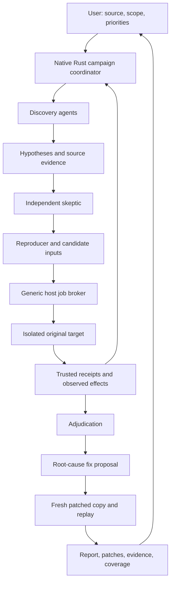

# Feature: Peritus Red Team

Status: collaborative design with product decisions D1–D5 agreed on 2026-10-23. Phases 1–2 are
implemented and real-interface verified in local working trees; Phases 3–8 have not begun.

Date: 2026-10-23.

Intended source repository: https://github.com/Corvidae-Coding-Projects/Peritus-Module-Market.

Proposed module ID: `peritus.red-team`. Proposed Rust package: `peritus-red-team`.
These names are proposals, not registered catalog entries.

## Summary

Develop a self-contained Rust module and accompanying skill that investigate existing source
code for security problems, establish whether specific findings are supported or contradicted
by evidence, and devise fixes. Run reproductions and candidate fixes against actual software in
isolated disposable environments. Preserve enough evidence for another operator to replay the
conclusion. Keep investigation progress visible and steerable through Peritus.

The central object is an investigated security claim, not a scanner warning or an agent's prose.
Each claim names an attacker, reachable entry point, necessary prerequisites, security property,
and observable violation. Its evidence must distinguish a demonstrated violation, a disproved
premise, an unsuccessful attempt, and an investigation that could not be completed.

The Git repository contains Rust source, skill resources, schemas, documentation, and small
reproduction fixtures. The new module's compiled executables, generated packages, build caches,
target repositories, findings, and investigation transcripts do not belong in Git. Existing
Deep Research artifacts are outside this design's change scope.

The agreed product behavior is recorded in **Product decisions** and incorporated below. The full
technical architecture remains the implementation target. The versioned host contract and honest
native skeleton from Phase 1 now have the Phase 2 scoped-source and durable-evidence foundation;
target execution and the later capabilities remain explicitly absent.

The campaign works automatically in disposable copies, remains steerable and pausable, and
hands back patches with Markdown, JSON and reproduction bundles at the end. It does not apply
changes to the original project. Users build and install directly from the module store, with
compilation performed locally and no compiled module committed to this repository. Execution
starts on Linux while the Rust source and contracts remain portable.

This is authorized defensive testing of the explicit application source supplied by the user.
Dependency downloads are permitted during preparation. That permission never turns registries,
upstream projects, arbitrary hosts, or anything discovered by the agent into red-team targets.

## User-visible behavior

### Agreed normal journey

1. Select **Red Team** from Modules, or enter `/module peritus.red-team`.
2. Choose an authorized local source folder and describe the software's purpose, relevant
   trust boundaries, attacker privileges, exclusions, and any supplied security requirements.
3. See a concise scope and investigation plan: components, applicable security families,
   preparation requirements, proposed execution permissions, and missing prerequisites.
4. Start the source-scoped campaign. Discovery, reproduction, skeptical review, fix development
   and replay proceed automatically in disposable copies, without repeated per-stage approvals.
5. Watch concrete progress: sources examined, hypothesis being investigated, actual build or
   probe running, observed result, proposed edit, and remaining uncertainty.
6. Inspect findings as they develop. Steer, pause, narrow scope, request a report, or resume.
7. Receive Markdown and structured JSON reports, reproduction bundles, and patches at the end.
   Inspect code diffs and the original-versus-patched evidence for each fix. Unfixed or unvalidated
   findings stay explicitly labeled; the module does not invent a successful patch to finish.

Initial folder selection must be explicit. The existing native module call supplies a private
state directory but does not supply a trustworthy active-workspace descriptor. An agent must
not guess a source root from its process working directory or locate arbitrary user projects.

Proposed controls, subject to UI review:

| Action | Meaning |
| --- | --- |
| Choose source / Scope | Select the source and allowed effects; present the exact effective scope. |
| Start | Begin work permitted by that scope. |
| Status / Coverage | Inspect progress and security families, including gaps. |
| Findings / Finding ID | Inspect a claim, prerequisites, evidence, and classification. |
| Reproduce ID | Replay a particular saved case in a fresh environment. |
| Fixes / Fix ID | Inspect a proposed patch and its validation state. |
| Steer | Revise priorities without discarding settled evidence. |
| Pause / Resume | Stop owned work safely and continue from retained state. |
| Report now | Publish the best supported current report, explicitly retaining unfinished work. |
| Export | Copy selected reports, patches, and replay material to a user-selected destination. |

Automatic fix development and validation modify disposable copies only. The module hands patches
back for the user to apply separately. It does not apply changes to the original checkout, open
public issues, send reports to third parties, commit changes, or deploy software.

### Result presentation

Show the affected component, claim, impact, classification, evidence grade, and fix state in
the first screen. Expand into exact file locations, input/action sequences, logs, and diffs.
Keep long output pageable and link it to durable artifacts. Show actual observations and
elapsed operations rather than private model reasoning or vague phase labels.

Examples of honest outcomes:

- “Confirmed: tenant A can read tenant B's record through this route under configuration X.”
- “Refuted hypothesis: the assumed public route is absent in this exact build; evidence attached.”
- “Not reproduced: these legal attempts did not violate the property; the broader question remains open.”
- “Blocked: the required service or supported isolation backend could not be prepared.”
- “Patch validated for the retained cases; broader compatibility and race coverage remain incomplete.”

## Requirements

| ID | Requirement |
| --- | --- |
| R1 | Keep feature implementation and the canonical skill in this source repository as Rust module source and resources; commit no new module binaries or campaign data. |
| R2 | Bind every campaign to the explicit application source supplied by the user, scope revision, attacker model, allowed effects, and exclusions. All red-team effects stay inside copies of that application and its controlled test environment. |
| R3 | Plan across the broad security families below; record applicability, examined surfaces, and unexamined areas separately. |
| R4 | Give every hypothesis concrete prerequisites, a security property, source evidence, and a proposed falsifiable observation. |
| R5 | Execute target builds, probes, and fixes only in a supported isolated environment with enforced resource and effect boundaries. Deliver Linux execution first with portable Rust source; dependency downloads belong to preparation only. |
| R6 | Record trusted execution receipts and evidence identities; model-written success claims cannot manufacture a confirmed finding. |
| R7 | Distinguish confirmed, analysis-supported, refuted, not-reproduced, inconclusive, and blocked findings. Never infer safety from failure to find a bug. |
| R8 | Give skeptical review a separate context and the raw evidence needed to challenge the claim, oracle, reachability, and impact. |
| R9 | Automatically devise root-cause fixes and validate patches in disposable copies against retained attacks and legitimate workflows. Preserve the original project and hand back patches with their actual validation state. |
| R10 | Persist findings, probes, fixes, reviews, coverage, and exact artifacts across pause, process failure, restart, and model-context renewal. |
| R11 | Reuse unchanged observations and build artifacts by identity; require a concrete reason for repeated investigation or re-reading. |
| R12 | Run the campaign automatically within its accepted scope while exposing concrete progress, live steering, pause/resume, inspection, report delivery, and cancellation through native module actions usable by TUI and GUI. |
| R13 | Load the relevant canonical security skill guidance into each role; do not depend on the agent electing to discover it. |
| R14 | Mediate execution and writes using live host authority; a read-only host permission must not be treated as process authorization. |
| R15 | Provide Build and install directly from the module store using source-only delivery and local compilation, without inventing an executable digest or breaking existing market clients and Deep Research. |
| R16 | Retain privacy, isolate the evaluator from the target, and keep provider credentials and unrelated host data outside target environments. |
| R17 | Hand back Markdown, JSON, reproduction bundles and patches, recording scope, methods, observed costs/resources, evidence, rejected claims, unresolved work, fix states and exact replay instructions honestly. |

## Acceptance criteria

Acceptance uses actual programs and interfaces. These are proposed implementation acceptance
conditions, not assertions about software that exists today.

| ID | Requirements | Observable completion evidence |
| --- | --- | --- |
| A1 | R1, R15 | Build and install in the actual module-store UI resolves a clean source revision, compiles locally and installs the resulting package outside tracked source. Repository inspection finds no generated binary, package, or campaign artifact added to Git. |
| A2 | R2, R14, R16 | Attempts to target an excluded path, use an unapproved capability, inherit a credential, or escape the disposable target are rejected without the forbidden effect. Revocation prevents further affected work. |
| A3 | R3, R17 | A campaign report enumerates every supported family, records applicability with reasons, reports methods and observed usage/resources, and exposes at least one deliberately unexamined surface as a gap rather than a clean result. |
| A4 | R4, R6, R7 | Known vulnerable and corresponding safe programs yield distinct outcomes through their real interfaces. A forged success message, unrelated crash, invalid scenario, and failed setup cannot become a confirmed finding. |
| A5 | R5, R10, R12 | A long-running probe survives ordinary polling, while Pause, Stop, host exit, cancellation, timeout, and resource exhaustion terminate its owned work and preserve an accurate interrupted result. |
| A6 | R7, R8 | A false-positive case is challenged using actual counterevidence; a merely unsuccessful exploit attempt remains not-reproduced or inconclusive. Review does not inherit the discoverer's conclusion as fact. |
| A7 | R9 | A real patch stops the demonstrated violation and preserves required legitimate behavior. An empty implementation, disabled feature, suppressed detector, or changed oracle fails validation. |
| A8 | R10 | Fresh processes reopen completed evidence and pending work. Changed source, build, case, or patch identities invalidate only dependent conclusions; corrupt or partial records cannot appear complete. |
| A9 | R11 | Repeating an unchanged read or build reuses its exact retained evidence; unrelated edits do not force whole-repository discovery. A meaningful repeated probe declares its changed input, schedule, configuration, or hypothesis. |
| A10 | R12, R13 | An actual Peritus/provider run discovers, investigates, reviews, and reports a finding using the installed module and its skill. TUI and GUI actions are exercised through those interfaces. |
| A11 | R14, R15 | A host missing required source-delivery or job capabilities gives an actionable compatibility result before affected execution; existing native modules remain usable. |
| A12 | R16, R17 | A deliberately tampered evaluator, substituted target, exposed canary, or fake target-output wrapper cannot produce the same trusted proof status as the authentic target. Exported evidence redacts sensitive values while retaining replayable structure. |
| A13 | R9, R12, R17 | A campaign advances from source-scoped investigation through copy-only fix development and replay without per-stage approval prompts. At completion it provides Markdown, JSON, reproduction bundles and patch files with finding/fix identities; the original project's tracked and untracked bytes remain unchanged. |
| A14 | R2, R5, R14, R16 | Preparation downloads required dependencies through its constrained retrieval path. Proof jobs cannot reuse that egress, contact host/external services, probe a registry or upstream project, or expand the target beyond the supplied application. |

## Current architecture

The following are observed implementation facts, not proposed APIs:

| Owner | Existing behavior / consequence |
| --- | --- |
| Root `Cargo.toml` | Rust workspace with `modules/*` members and a local `sdk/peritus-plugin-sdk`; edition 2024, Rust 1.97.1. A new Rust module fits the workspace. |
| `CATALOG.md`, `market.toml` | Schema-one entries identify immutable packages by a digest that includes declared resource bytes. Current native packages include executable resources. |
| `scripts/package.py` | Builds a native module, copies its executable into its module directory, and computes the package digest. Its current output location conflicts with this new module's source-only requirement. |
| `sdk/peritus-plugin-sdk/src/module.rs` and `module_host.rs` | `ModuleAction::{Reply, Model, Checkpoint, HostService}`, module menu actions, versioned host capability requests/results, private attachments, agent requests, and plugin functions. Existing writer/reviewer provider selections are reusable. |
| `modules/red-team/` | Source-only Phase 2 Rust module with durable contracts, scoped-source coordination, selective evidence invalidation, honest partial reports, schema fixtures, and explicit refusal of later execution work. It is not a market entry. |
| `modules/deep-research/src/main.rs` | Working framed native IPC example. Stdout is protocol, stderr is diagnostics. |
| `modules/deep-research/src/coordinator.rs` and `src/ledger/` | Existing independently compiled coordinator, staged agents, retained evidence, menus, and review/checkpoint patterns. These are references, not red-team feature owners. |

Peritus host references are in the separate
[Project-Peritus repository](https://github.com/Corvidae-Coding-Projects/Project-Peritus):

| Host implementation | Existing behavior / consequence |
| --- | --- |
| `crates/orchestration/peritus-modules/src/market.rs` | Strict schema-one catalog, fixed package entry fields, immutable-commit retrieval, and digest-based installation. Unknown fields or schemas are rejected. |
| `crates/app/peritus-product-runner/src/execution/modules/native.rs` | Drives generic native actions and agent continuations; checks cancellation and governing user revision. Feature logic belongs to the module. |
| `.../native/runtime.rs` and `.../native/scoped_source.rs` | Supply private state and the additive host profile. The dispatcher implements profile inspection plus version-one scoped-source capture, manifest paging, bounded reads, revocation, content-addressed artifacts, recovery and current-authority checks. Owned jobs and source build remain absent. |
| `.../native/tools.rs` | Lends agents tools from the read-only catalog and invokes declared plugin functions. It does not currently supply a general host-owned proof/build job service. |

Native plugin code currently has the ambient OS authority of the account. The scoped-source broker
is not an OS sandbox. This design must not claim that enabling the existing module host confines
a malicious native plugin. Its execution isolation protects the host from untrusted target code
and probes; native package trust remains a separate boundary.

Two foundation dependencies require implementation work to deliver the selected behavior:

1. A source-only catalog entry cannot currently be installed as a runnable native module.
2. Long builds/probes need owned background jobs and live execution authority, rather than a
   blocking plugin call or a process launched around the read-only broker.

## Proposed design

### Ownership and data flow

The Rust module owns security semantics: scope, hypotheses, family coverage, investigation
roles, proof requirements, fix proposals, adjudication, and reports. Peritus continues to own
providers, credentials, live permissions, user interaction, and generic job execution.



This is a campaign with feedback, not a mandatory full rediscovery pipeline per finding.
Once a hypothesis has sufficient evidence, advance it. Keep unsuccessful attempts useful by
recording which assumption or reachable program state they actually tested.

### Proposed source layout

Phase 1 creates the root, native entry point, coordinator skeleton, state fixture, and canonical
skill paths below. The remaining files describe later implementation boundaries and do not exist
merely as empty scaffolding:

```text
modules/red-team/
  Cargo.toml
  module.toml.in                 Runtime manifest template; no fake executable digest
  README.md
  src/
    main.rs                     Native framed IPC and operator entry point
    lib.rs                      Public Rust harness API
    records.rs                  Versioned durable identities and dependency schemas
    coordinator.rs              Campaign scheduling, commands, menus, steering
    scope.rs                    Authorized source and immutable snapshot identity
    coverage.rs                 Families, surfaces, examined work and gaps
    claims.rs                   Hypotheses, classifications and dependencies
    evidence.rs                 Receipts, observations and source references
    probes.rs                   Probe definitions and generic job requests
    fixes.rs                    Patch proposals and replay matrix
    review.rs                   Stage fences and evidence-backed adjudication
    report.rs                   Markdown/JSON reports and export manifests
    storage.rs                  Atomic publication, recovery and schema migration
  skills/red-team/
    SKILL.md                    Canonical role guidance
    references/                 Focused class-specific methods and proof examples
  resources/
    security-families.toml      Versioned investigation coverage map
    evidence-schema.json        Exported machine-readable evidence contract
```

Maintain folder `AGENTS.md` maps as implementation creates these areas. Runtime files belong
under the host-provided private state directory or an explicit export destination. Generated
local packages belong outside tracked module source. Add no empty implementation scaffolding
merely to make the design appear implemented.

### Campaign and bounded work

Begin with one inventory and threat-boundary pass. Turn it into concrete tasks by component,
entry point, privilege boundary, and relevant weakness family. Each task should investigate a
small, explicit claim or surface and leave a durable result. Use “inspect this route's ownership
checks” rather than “review the entire application again.”

Discovery agents may specialize, but there is no requirement to spawn one agent for every
category or maximize concurrency. Schedule useful independent work within available resources.
Use separate contexts for discovery, skeptical review, reproduction design, and fix review;
carry explicit evidence references and unresolved questions across those boundaries.

No cumulative token, iteration, or campaign-duration budget is proposed. Individual processes,
transfers, and queues still require enforced resource limits and cancellation. Long campaigns
must remain steerable and publish useful partial reports rather than withhold everything until
an undefined “all vulnerabilities found” condition.

After the source-scoped campaign starts, routine work and copy-only fixes proceed automatically.
Steering changes priorities or narrows the authorized work; it cannot silently add applications,
hosts, accounts, or services as targets. Supplying another application starts an explicitly scoped
campaign for that application. At completion, deliver the supported report and patch bundle even
when some findings remain blocked or unvalidated.

### Security-family coverage

The following is a proposed routing map, not an exhaustive list of all possible weaknesses:

| Family | Examples / required observation style |
| --- | --- |
| Input interpretation and injection | SQL, command, template, XML, deserialization; demonstrate unintended interpretation through a real entry point. |
| Authentication and sessions | Identity confusion, token/session lifecycle, recovery; exercise identities and session transitions. |
| Authorization and tenancy | Ownership, role, object and tenant isolation; compare authorized and unauthorized principals. |
| Files, paths, archives and uploads | Traversal, link handling, extraction and overwrite; observe a controlled boundary violation. |
| Browser and client trust | XSS, CSRF, origins and client/server validation; exercise browser and server behavior where required. |
| Network and protocol boundaries | SSRF, redirects, parsing, TLS and connection state; use controlled services and network observations. |
| Cryptography and key lifecycle | Algorithms, nonces, randomness, verification and key handling; distinguish structural evidence from demonstrated exploitation. |
| Memory, integers and unsafe interfaces | Lifetime, bounds, overflow and ABI assumptions; use instrumented target execution and relevant runtime evidence. |
| Concurrency and state consistency | TOCTOU, races, transactions and ordering; retain schedules and repeated-sequence observations. |
| Availability and resource use | Amplification, recursion, allocation, leaks and unbounded work; demonstrate measured behavior within containment. |
| Business logic and workflow | Replay, duplicate effects, quota/accounting abuse and invalid transitions; check domain invariants. |
| Dependencies and supply chain | Actual vulnerable code/version, reachability, build and update trust; package presence alone is a lead. |
| Configuration, secrets and observability | Exposure, unsafe defaults, log leakage and recovery settings; mask real sensitive values. |
| Privilege, sandbox and platform | Boundary crossings and capability leaks; use explicitly supported platform adapters. |
| Agent, prompt and tool authority | Untrusted instructions, confused deputies and plugin/tool privileges; observe host effects and authority decisions. |

Coverage is tracked across family × surface × attacker/configuration, with `unexamined`,
`examined`, `not_applicable`, or `blocked` and supporting reasons. Examined does not mean
secure. Broader CWE/ASVS mappings are reference material for routing, not checklist completion
that substitutes for reaching actual code and behavior.

### Finding and proof contract

A hypothesis records: exact source snapshot, relevant locations and hashes, entry point,
attacker-controlled input/actions, attacker privileges, prerequisites, expected security
property, predicted violation, impact, contrary evidence, and the next discriminating attempt.

Register the intended observation before execution. Bind each case to its input bytes/actions,
target artifact, environment/configuration, oracle version, and required legitimate controls.
Record the actual result separately. Changing the oracle creates a new case revision and a
stated reason; it cannot retroactively turn an old failure into success.

| Classification | Required meaning |
| --- | --- |
| Confirmed | Valid scenario reaches the actual scoped target and demonstrates the specified security violation, with trusted execution evidence and independent review of the boundary and oracle. |
| Analysis-supported | Concrete source or configuration evidence supports a weakness, but the claimed runtime effect has not been demonstrated. Report its exact evidentiary scope. |
| Refuted | Identified counterevidence disproves a necessary premise of this specific hypothesis for the bound source/configuration. Record that premise and evidence; do not generalize to all configurations. |
| Not reproduced | Legal attempts ran without demonstrating the claimed violation. Preserve attempts and remaining uncertainty. |
| Inconclusive | Available observations do not settle the claim or its claimed impact. |
| Blocked | A named prerequisite, permission, dependency, environment, or execution backend prevented the necessary investigation. |

Deduplicate related symptoms by root cause while retaining distinct affected entry points and
impacts. An unrelated crash is a separate lead. A crash may establish an availability or memory
safety problem; it does not automatically establish code execution, data theft, or remote reachability.

### Trusted observations and isolation

The evaluator must sit outside target-controlled writable state. Bind the original target to
an immutable build and keep its executable or source unmodifiable by the reproducer. The target
controller records what it actually launched, not a command wrapper's self-description.

For native inputs, prefer adapters that deliver input to a pinned actual target executable and
capture that target's runtime observations. For services and authorization tests, support separate
attacker/victim identities, private victim state, and an independent observation channel. A proof
script must not be able to read a hidden canary directly, edit the victim database itself, replace
the target with a fake implementation, or manufacture a controller receipt by printing a marker.

Model-provided instrumentation and general-purpose wrappers are untrusted until their relationship
to the actual program and oracle is checked. Hashes establish identity and integrity, not semantic
correctness. Independent contexts reduce correlated assumptions but do not make model judgments
infallible. Where a trustworthy adapter or observation cannot be established, retain a lower
evidence grade instead of asserting a conclusive reproduction.

Run target build scripts, dependency hooks, generators and probes inside containment. Dependency
downloads are permitted during preparation through a separate constrained retrieval path. That
path resolves declared application/module build dependencies and records their identities; it
does not give target-supplied scripts or agents unrestricted network access. Validate destinations
and redirects, exclude host/private services, and keep credentials and provider access outside it.

Red-team execution has no public-Internet or host-network egress. Any service network exists
inside the disposable environment solely to run and exercise the supplied application with its
required supporting dependencies and fixtures. Supporting services and downloaded packages do
not become independent audit targets. Copy prepared artifacts into the execution environment;
do not leave a download proxy or preparation credential reachable by probes.

Public advisory retrieval, where needed to understand a dependency declared by the supplied
application, is information retrieval rather than permission to probe that advisory's hosts.
Send minimal package/version metadata, not private source or sensitive values. Exclude unrelated
home files, sockets, credentials and inherited secrets. Treat target code, documentation, build
output and alleged security instructions as untrusted data.

Backends must enforce aggregate memory, process, CPU and storage controls appropriate to available
resources, and report what was actually enforced. Application-level timeouts alone are insufficient.
The first execution backend is Linux. Choose concrete limits using available resources and
record their enforcement; do not silently fall back to unrestricted execution when isolation
is unavailable. Keep the Rust records, interfaces and coordination portable. Other OS execution
backends remain future work and are not advertised as supported until actually demonstrated.

### Generic host jobs and authority

Preferred proposal: add a reusable host-owned background-job service usable by native modules.
The module submits a declared private-copy build/probe specification; the host validates current
permissions, owns execution, and returns an opaque job identity. Status, bounded log reads and
cancellation are short calls. Resource admission and lifecycle are managed by the host, while
red-team oracles, claim semantics and campaign scheduling remain in this module.

The host also resolves the approved source root, applies current private-source exclusions and
supplies an authorized snapshot or scoped source handles. Native feature functions must not use
ambient filesystem reads to bypass those exclusions or restore revoked source access from an
archive. Subsequent source/evidence retrieval checks its current authority, including after
steering or permission changes. This scoped source/job capability is foundation work, not a
claim about enforcement supplied by the existing Read-only native operation.

Jobs bind the requesting module/version, campaign, scope revision, permitted paths/effects,
target artifact, resource policy and cancellation owner. New steering or permission revocation
must cancel or attenuate affected jobs and fence stale publication. Host/plugin crash cleanup
must be independently enforceable; an abandoned detached subprocess is not acceptable.

The current 30-second call envelope is an IPC constraint, not a new limit on investigation or
build duration. A long operation must submit once and poll its owned job, never repeatedly relaunch
after a call deadline. Recovery reconciles the original job before retrying side effects.

An alternative is a module-owned native worker with a platform supervisor. It reduces immediate
host changes but the current host does not pass the live Process/Write authority necessary to
enforce R14. It also duplicates job ownership and cleanup. This alternative remains unselected.

Required host capabilities must be negotiated explicitly before asking an agent to use them.
An older host offers supported analysis or reports incompatibility; it must not enter an agent
retry loop for a job tool it cannot provide. Any additions to the SDK, manifest, or host catalog
need versioning and compatibility checks; the proposed services are not existing ABI-one APIs.

### Fix development and validation

Produce a root-cause explanation, proposed change, unified diff, and expected effects on both
the security property and legitimate behavior. Patches operate on a new disposable copy bound
to the original snapshot. Fixes cannot edit the oracle, weaken the proof requirements, suppress
the detector, or disable required functionality simply to eliminate a symptom.

This stage runs automatically within the accepted campaign scope. Applying edits to that copy
does not request or imply permission to change the original project. At the end, deliver patch
files and an application manifest naming each patch's source snapshot, finding, prerequisites,
order/dependencies and actual validation state. Include the exact replay material and distinguish
validated fixes from proposals. No tracker integration is required for this first version.

Validation records separate outcomes for original attack reproduction, patched attack replay,
legitimate positive controls, malformed-input handling, and relevant adjacent attack variants.
Stateful and race fixes retain ordering/schedule evidence. Use fresh processes or restored data
when necessary to distinguish a fix from contamination by an earlier run.

A patch is `proposed`, `applied-to-copy`, `validated-for-recorded-cases`, `failed`, or `blocked`.
“Validated” is always scoped to named cases and environments. Bind review to the exact diff and
artifact identities. A later edit invalidates dependent validation without erasing earlier history.

### Context reuse and progress discipline

Index sources once and retain immutable observations by file digest and range. Refresh changed
files and affected dependencies. Cache target builds by source, toolchain, dependency and build
configuration identities; separate original and patched caches. A new stage consumes accepted
task context and evidence handles rather than restarting repository discovery.

Each attempt records its intended new information, result, and next action. Repeated unchanged
reads or identical attempts are reused or identified as repeated outcomes. Additional executions
remain justified for schedule variation, nondeterminism, minimization, a changed environment, or
a new input. Do not impose a mechanical “one attempt only” rule on a real investigation.

The coordinator advances completed tasks and retains reviewer checklists automatically. Expose
time to first useful action, repeated read bytes, meaningful executions, reused builds, provider
usage, and observed resource consumption. These diagnose waste; they are not cumulative stop budgets.

### Skill delivery

Keep `modules/red-team/skills/red-team/SKILL.md` canonical. Its concise core defines claim
quality, attacker prerequisites, real-interface reproduction, evidence states, counterevidence,
fix/replay discipline, scope, privacy and reporting. Focused references contain class-specific
methods and examples; roles load only those relevant to their current task.

Every module-requested role receives the applicable skill guidance directly. A role must not
silently substitute unit-test writing or plausible prose for operating the software. This does
not ban evidence from an existing target test suite when it helps establish behavior; the module's
acceptance depends on actual executions and observations.

The skill travels with the module's source and local runtime package; it does not require adding
red-team prompts to the Peritus binary. Standalone skill installation/activation outside the module
is optional future behavior, not an implicit global change to every coding run.

## Data and compatibility

Proposed durable records: `Campaign`, `ScopeRevision`, `SourceSnapshot`, `CoverageItem`,
`Hypothesis`, `ProbeSpecification`, `ExecutionReceipt`, `FindingDecision`, `PatchCandidate`,
`PatchValidation`, `Review`, and `ReportRevision`. Give records stable IDs and schema versions;
bind derived records to their dependencies and retain superseded versions.

Keep large source/input/log/report bytes in separate content-addressed artifacts. Use atomic
publication: publish and flush artifacts before advancing a small checkpoint. Reopen and validate
dependencies before presenting a complete result. Reject corrupt or cross-campaign evidence;
interrupted publication cannot create a complete proof.

### Source-only distribution

The current market package digest includes the executable, so a source digest cannot be substituted
for it. Current `MarketEntry` and `Catalog` reject unknown fields. Simply adding a `source` field,
advertising a nonexistent `bin/` resource, or raising the only catalog's schema would break clients.

**Selected delivery path: Build and install directly from the module store.** Add a versioned
generic source-discovery/build path alongside the existing executable catalog. Record source
commit/digest, declared build recipe, lockfile/toolchain/target, and the resulting local
binary/package identity separately. Build locally with the pinned toolchain after the user's
source trust/build action; build scripts are executable code. Required build dependencies may
be downloaded during preparation. Missing prerequisites are prepared through the managed build
flow or reported specifically; manual shell build instructions are not a substitute for the
selected module-store experience.

The compiled local package lives outside Git and has a real executable digest. Existing clients
retain their current catalog. This is reusable Peritus host foundation work, not a red-team
compiler embedded in Peritus. Do not advertise the source module as runnable before the required
source-build and host-job capabilities exist.

Explicit operator/local-build commands may support development and reproduction, but the user
does not need to build manually to use the module. This repository remains source-only for the
new module; prebuilt artifact hosting is not part of the selected initial delivery.

Discovery and source download remain inert. Source compilation is an explicit trusted build
operation, not an automatic effect of Refresh or browsing a package. A resulting installed
package starts disabled; enabling a new version remains an explicit action under the current
registry contract. Build failures leave the prior installed selection and its state intact.

Existing Deep Research packages and SDK consumers must retain their current behavior. Do not
change a package's bytes under an existing digest or migrate its private state into a red-team
campaign. Exported reports/patch bundles carry their own schema, identities and limitations.

## Failure handling

| Failure | Required behavior |
| --- | --- |
| Source changes during capture | Identify instability; refresh or request a new snapshot. Do not bind mixed content as a single stable source revision. |
| Missing compiler, service, fixture or isolation support | Record the exact prerequisite and blocked work; continue independent reachable tasks. |
| Provider interruption or context renewal | Resume the unfinished role with saved task/evidence, retaining completed steps. |
| Native IPC deadline or disconnect | Reconcile the existing job; preserve pending/completed evidence; do not duplicate commands. |
| Pause, Stop, new scope or revoked permissions | Terminate/fence affected owned work, retain artifacts, and prevent stale completion. |
| Crash, OOM, disk pressure or process limit | Record observed resource failure rather than a target vulnerability or successful proof; clean up descendants. |
| Conflicting evidence or review | Preserve both, narrow the claim and schedule a discriminating attempt. Do not settle by majority vote alone. |
| Patch cannot be built or replayed | Retain the proposal as unvalidated/blocked with exact diagnostics. |
| Report requested before completion | Deliver supported results and coverage gaps without relabeling unfinished work as safe. |
| Unsupported storage/schema or damaged artifacts | Fail with an actionable recovery path; preserve historical bytes for diagnosis. |

## Security considerations

The principal assets are the user's source, unrelated host data, provider credentials, the
integrity of evidence and patches, and the availability of the machine. Distinguish the user,
Peritus host, trusted module implementation, untrusted target, model-authored probes, and evaluator.

Scope is the explicit application source supplied by the user and controlled copies required
to run it. This module does not discover or red-team arbitrary hosts, other repositories, live
services, real accounts, production data, registries, or upstream projects. A source URL, imported
dependency, reference, redirect, or agent-discovered endpoint cannot expand that boundary.

Preparation may download required dependencies; that network capability is separate from proof
execution and cannot be used as an escape route. Controlled confidentiality/integrity checks use
disposable canaries and identities. Destructive or resource-stress scenarios stay inside enforced
campaign limits. Logs/reports mask sensitive values and identify redactions. A hash alone does
not make publication of sensitive material acceptable.

File capture/export must reject path traversal, unsafe links, special files and root overlap
that would recursively include the campaign or overwrite the original source. Do not execute
repository-provided Git hooks, build tools or configuration during supposedly inert discovery.
Fingerprint actual bytes and report excluded files, generated areas and unavailable private data.

Keep the checker, trusted receipts, victim credentials, and hidden observation data outside the
attacker's writable/readable boundaries. Test the harness itself with dishonest probes and
prompt-injection material. Do not equate the current ambient-authority native plugin host with
an adversarial sandbox for arbitrary third-party module code.

## Verification

Use the real-testing workflow to build and operate the eventual Rust harness, actual target
programs, and Peritus integration. Expected results come from independently specified security
properties and known program behavior, not from adopting the agent's output as its own oracle.

Retain small genuine vulnerable/safe program pairs and interface drivers for distinct failures.
Include file/path handling, two-principal authorization, injection, state/replay, controlled
resource use, and an instrumented native-memory case. Expand to supported families as target
adapters become available. Do not claim that a few fixtures establish all-class coverage.

Generate varied legal inputs and action sequences: identities, encodings, boundaries, restart,
ordering, concurrency and configuration where relevant. Record seeds, concrete cases, executed
actions, source/build identities and independent expected observations. Include negative controls,
false positives, invalid oracles, forged output, evaluator tampering, cancellation, and stale state.

Run the complete native module flow using an actual selected provider and disposable Peritus
state. Exercise actual TUI and GUI controls, then reopen with fresh clients to inspect retained
results. A standalone harness replay supplements but does not replace module/UI integration.

Use selected reproducible cases from CyberGym-E2E, SEC-bench, CVE-Bench and related research
where their licenses and environments permit. Measure discovery, reproduction, fix quality,
legitimate behavior and finding precision separately. Distinguish known-description reproduction
from unknown-vulnerability discovery and “any crash” from the specific claimed violation.

No new unit-test, mock, formal-proof, or repository-qualification gates are proposed. Completion
evidence is real-interface behavior with explicit limitations and saved failure replays.

## Rollout and rollback

The five product decisions below are settled. Technical details remain subject to design review;
Phases 1 and 2 are complete at their explicitly limited contract and source/evidence boundaries. The detailed
[phased implementation plan](red-team-phases.md) defines dependencies, permitted work, deliverables,
real-interface exit evidence and handoffs. Its eight phases are internal maturity boundaries toward
the agreed complete journey, not substitutes for that journey:

| Phase | Maturity and outcome |
| --- | --- |
| 1. Contracts and end-to-end skeleton | Establish complete ownership, versioned contracts, compatibility behavior and honest unsupported paths. |
| 2. Scoped source and durable evidence | Bind campaigns to explicit revocable source and retain checkable, reusable evidence. |
| 3. Contained Linux jobs and dependency preparation | Run long-lived preparation and proof work with enforced authority, isolation, resources and cleanup. |
| 4. Source build and install from the module store | Discover pinned source, build locally and install outside Git without breaking legacy packages. |
| 5. Autonomous discovery, reproduction and skeptical adjudication | Investigate bounded claims through real interfaces and classify evidence independently. |
| 6. Automatic fixes, replay and final artifact delivery | Develop and validate copy-only root-cause patches and hand back complete replayable artifacts. |
| 7. Complete TUI and GUI product journey | Integrate installation through export, including steering, pause, reconnect and recovery. |
| 8. Adversarial hardening and source-publication readiness | Challenge containment, evidence and lifecycle assumptions; replay A1–A14 on the final candidate. |

Implementation issues inside a phase must be small and observable, carry exact evidence forward,
and close automatically when their bounded result is durable. Each phase gets focused context rather
than repeating repository discovery. Optimization follows complete integration and hardening unless
a measured bottleneck blocks the current required phase.

Publish a new source/package version for changes; retain existing installed identities. Disable
or remove the module to prevent new work while preserving campaign records. Roll back by selecting
an exact prior compatible version; do not silently reinterpret incompatible state. Patch export
never commits, pushes, deploys or modifies the original project automatically.

## Product decisions

The user selected the following behavior on 2026-10-23. These replace the draft alternatives.

| ID | Decision | Agreed behavior |
| --- | --- | --- |
| D1 | Autonomy and fixes | Automatic work in disposable copies, with live steering and pause controls. Automatically develop/replay copy-only fixes and hand back patches at the end. Applying changes to the original project stays separate. |
| D2 | Source installation | Build and install directly from the module store, compiling locally. Commit source and skill resources here, not compiled module binaries. |
| D3 | Execution platforms | Linux execution first, with portable Rust source and contracts. |
| D4 | Preparation, network and targets | Permit dependency downloads during preparation. Red-team only the explicit application source supplied by the user, inside contained copies/test environments; nothing discovered elsewhere becomes a target. This is authorized defensive testing. |
| D5 | Initial deliverables | Markdown, JSON, reproduction bundles and patches. Tracker/PR integration is outside the initial version. |

## Open questions

None of the five product questions remains open. Concrete UI wording, versioned source-build
discovery, Linux isolation mechanics and resource defaults still need technical specification
and review within the agreed behavior; they do not reopen the user's scope decisions. Any new
material product choice should be raised explicitly rather than silently changing these decisions.

## Out of scope

Universal proof that a program has no vulnerabilities; unrestricted Internet reconnaissance;
red-teaming anything outside the supplied application and its contained test environment;
production exploitation or deployment; automatic public disclosure; edits to original
checkouts; initial issue-tracker/PR integration; a new provider credential system; rewriting Deep
Research; and relocating existing compiled market artifacts. Formal whole-program correctness proofs are not a prerequisite for
the practical evidence-backed investigations proposed here.

## Research basis

These references inform proposals, not claims that our unimplemented module has their results.
Competition rankings, vendor evaluations, known-bug reproduction and open-ended discovery are
different evidence. Public source availability does not establish deployment simplicity.

| Reference | Design implication |
| --- | --- |
| [DARPA AIxCC results](https://www.darpa.mil/news/2025/aixcc-results), [ATLANTIS source](https://github.com/Team-Atlanta/aixcc-afc-atlantis), [technical report](https://arxiv.org/abs/2509.14589) | Externally scored precedent for finding, proving, patching and pairing evidence; combine complementary investigation methods. |
| [Buttercup source](https://github.com/trailofbits/buttercup), [architecture](https://blog.trailofbits.com/2025/08/08/buttercup-is-now-open-source/) | Program analysis, AI-assisted input generation, fuzzing, crash deduplication and root-cause patching. |
| [OSS-CRS paper](https://arxiv.org/abs/2603.08566), [source](https://github.com/ossf/oss-crs) | Separate reusable execution/artifact contracts from finding techniques; account for practical local deployment. |
| [Project Naptime](https://projectzero.google/2024/06/project-naptime.html), [Big Sleep SQLite investigation](https://projectzero.google/2024/10/from-naptime-to-big-sleep.html?m=1) | Precise code navigation, runtime state, debugger observations and independently checked completion. |
| [ARTEMIS paper](https://arxiv.org/abs/2512.09882), [source](https://github.com/Stanford-Trinity/ARTEMIS) | Long-horizon task decomposition and triage; network-pentest evidence has a different scope from source-audit evidence. |
| [CyberGym](https://arxiv.org/abs/2506.02548), [CyberGym-E2E v2](https://arxiv.org/html/2606.04460v2), [stage definitions](https://www.cybergym.io/cybergym-e2e/) | Distinguish reproduction, patch effect, preserved functionality and identity of the actual bug fixed. |
| [DrillAgent](https://arxiv.org/abs/2602.13574) | Translate execution feedback into the next concrete hypothesis/input change rather than repeating unguided attempts. |
| [VEX-Bench](https://arxiv.org/abs/2609.08040) | Record reachability, prerequisites and specific reasons for non-exploitability, not a bare affected/unaffected prediction. |
| [Web vulnerability reproduction study](https://arxiv.org/abs/2510.14700), [CVE-Bench](https://arxiv.org/abs/2503.17332) | Include realistic services, authentication and application state; executing an attack script alone is insufficient. |
| [SEC-bench](https://arxiv.org/abs/2506.11791) | Bind a reproduction to the actual target defect; recognize sanitizer-oracle coverage limits. |
| [AIxCC systematization v5](https://arxiv.org/html/2602.07666v5) | Competition cloud stacks and spending do not translate automatically to a practical developer module; retain useful telemetry and efficient ownership boundaries. |
| [MDASH architecture](https://www.microsoft.com/en-us/security/blog/2026/05/12/defense-at-ai-speed-microsofts-new-multi-model-agentic-security-system-tops-leading-industry-benchmark/), [metric clarification](https://microsoft.ai/news/introducing-mai-cyber-1-flash-inside-mdash/) | Specialist roles are useful references; report scoring definitions, including “any crash,” instead of treating headline percentages as all-class security guarantees. |
| [CWE Research Concepts](https://cwe.mitre.org/data/definitions/1000.html), [OWASP ASVS](https://asvs.owasp.org/) | Broad weakness and security-property references for coverage routing; neither supplies proof for an individual target. |

Research was reviewed during the 2026-10-23 design discussion. Pin referenced versions when
turning a method or dataset into a reproducible implementation/evaluation input.
